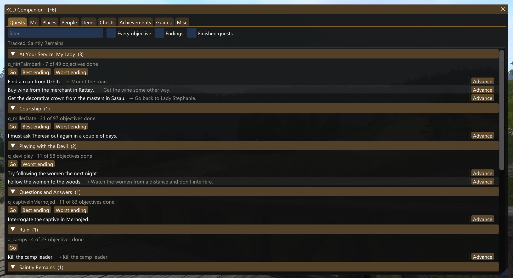
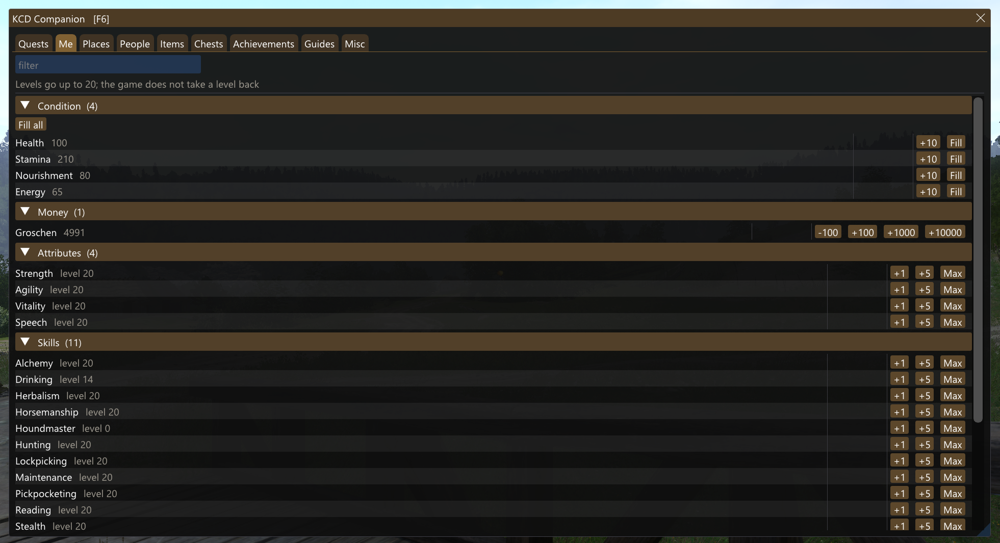
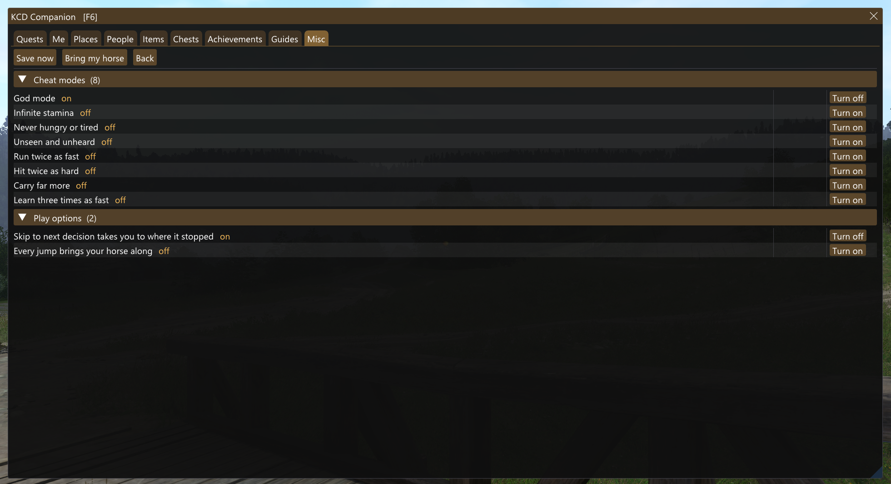
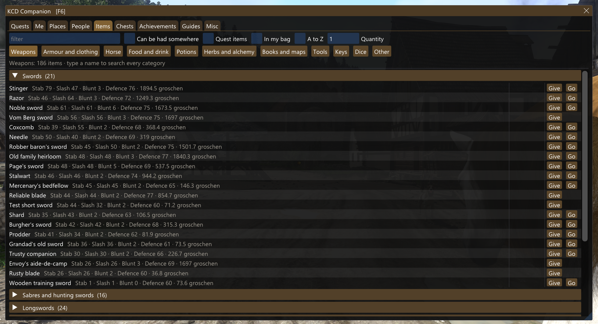
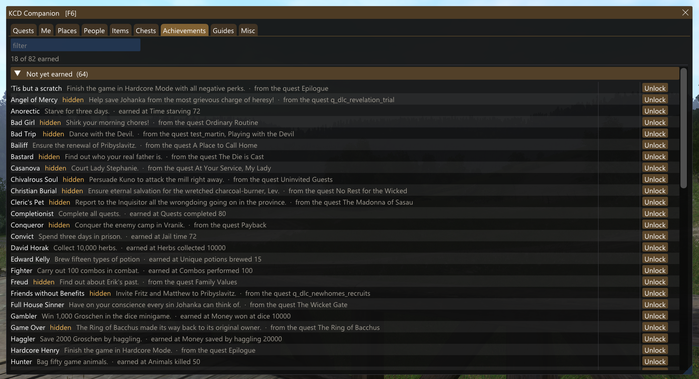
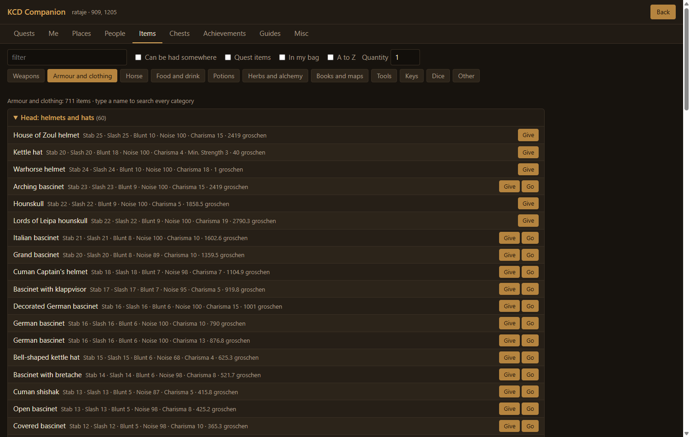

# KCD Companion

The full suite for **Kingdom Come: Deliverance**, in one window inside the game (**F6**) or a browser panel on a second screen. **Quests**: go straight to your current objective, skip the busywork up to the next real decision, or finish a quest on its best or worst ending. **Items**: all 2,052 laid out like a shop, best first with their damage, armour and price; give yourself any of them, or go to where one is sold or lying. **Achievements**: see which of the 82 you have and the quest or counter behind each, and unlock any of them. Then Henry's stats, skills and money, eight cheat modes, and every person, place and chest around you.

**Quest Autopilot is inside**: its quest graph, safe advance, skip-to-decision and ending catalogue (135 quests, 506 endings) drive the Quests tab, and its `st_*` console commands still work.

| | |
|---|---|
|  |  |
|  |  |

## Features

- **Quests**: every started quest with its current objectives as journal lines; **Advance** completes one when its prerequisites are met (**Force** when they are not); **Go** to the current objective; **Skip to next decision** completes busywork and stops at a decision; **Best ending** and **Worst ending** run a quest to the outcome its writers marked. The quest's people with Go and Summon; views of every objective, every ending and finished quests.
- **Items**: all 2,052 in a category bar like the inventory's (weapons, armour and clothing, horse, food and drink, potions, herbs, books and maps, tools, keys, dice), each category in the groups you look for: swords to arrows, helmet to boots, healing to poison, skill books by skill, keys by village and house. Best first, with stab, slash, blunt, defence, noise, charisma or nourishment and the price beside each name. **Give** any quantity; **Go** to the shops, chests and spots one can be had, nearest first.
- **Achievements**: all 82 Steam achievements with your earned state and date, each with the quest or counter behind it; **Unlock** sets an unearned one on your Steam account.
- **Me**: health, stamina, nourishment and energy (refill one or all), groschen in steps up to +10,000, the four attributes and eighteen skills (+1 / +5 / Max).
- **Misc**: Save now (no Saviour Schnapps), Bring my horse, and eight **cheat modes**: God mode, Infinite stamina, Never hungry or tired, Unseen and unheard, Run twice as fast, Hit twice as hard, Carry far more, Learn three times as fast.
- **People**: everyone loaded around you, by in-game name, with Go and Summon.
- **Places**: villages, towns, monasteries and inns with their shops, alchemy tables, grindstones, baths and beds; towns land where the game's own fast travel lands; **Mark** and **Back**.
- **Chests**: every chest and stash in the level, locked ones marked.
- **F8** goes to the current objective of the quest you last picked in the journal.
- Jumps work on foot and on horseback and land on the floor.
- **Languages**: follows your game's language setting. The Companion's own words are in English, Chinese, French and German; a game set to any other language gets English. Names of people, places, items, quests and journal lines always come from the game's own text, in whatever language it runs.

## Install

**Installer**: download **`KCD-Companion-1.1.0-Installer.exe`** from the [latest release](../../releases) and run it. It finds the game through Steam (or paste the game folder), installs with one click, updates and uninstalls, and shows the panel in its own window while the game runs. Windows may warn about an unknown publisher: More info > Run anyway.

**Manual**: download **`KCD-Companion-1.1.0.zip`** from the same release and extract it into the game folder (Steam: right-click the game > Manage > Browse local files), keeping its folders. Start the game and load a save; press **F6**, or open **http://127.0.0.1:17603** in a browser on the same PC. `INSTALL.txt` in the zip lists every file it adds; deleting them uninstalls it. Coming from Quest Autopilot: extract over it; KCD Companion replaces its two files in `Mods\QuestAutopilot`.

**Nexus Mods**: https://www.nexusmods.com/kingdomcomedeliverance/mods/2406

## Compatibility

Built and tested on Steam build **1.9.8** (22623230). Unlock on the Achievements tab checks the game's reward code byte by byte and stays off on another version. Test on a copy of your save first.

## Kingdom Come: Deliverance II

The second game's trainer, with the same window, panel and tabs, is **KCD2 Companion**: https://github.com/registered2nd/kcd2-companion (Nexus Mods: https://www.nexusmods.com/kingdomcomedeliverance2/mods/3812).

## Credits

Original mod code. The cheat modes' buff technique (a mod's own `buff__<mod>.xml` and the engine's stat codes) follows [kcd-cheat](https://www.nexusmods.com/kingdomcomedeliverance/mods/1183). Uses Ultimate ASI Loader (MIT) to load the plugin, Dear ImGui (MIT), MinHook (BSD-2) and nlohmann/json (MIT). Not affiliated with Warhorse Studios or Deep Silver.
